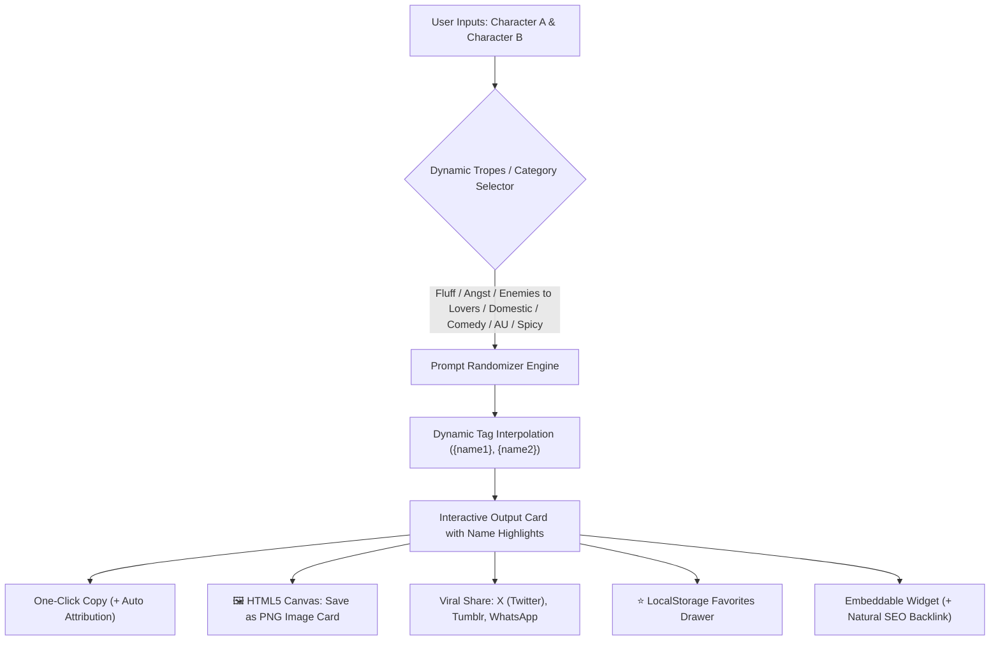

# Relationship Headcanon Generator
> A modern, viral Fandom & Shipping Relationship Headcanon Generator WordPress plugin designed to boost dwell time, social shares, and natural backlinks.

[](https://wordpress.org)
[](https://php.net)
[](https://www.gnu.org/licenses/gpl-2.0.html)
[](https://catchaiinfo.com/tools/relationship-headcanon-generator/)

---

### 🌐 Live Tool & Interactive Demo
Experience the live, interactive generator in production:  
👉 **[https://catchaiinfo.com/tools/relationship-headcanon-generator/](https://catchaiinfo.com/tools/relationship-headcanon-generator/)**

---

## 🌟 Overview & Architecture

**Relationship Headcanon Generator** is built for fanfiction creators, OTP shippers (Tumblr, X/Twitter, AO3, Wattpad), roleplayers, and creative writers. Users can input any two character names, select relationship tropes/dynamics, and instantly produce rich, customized headcanons, scenarios, and prompts.

The plugin was engineered specifically as an interactive **SEO asset** to drive high average session duration, organic viral social sharing (via client-side quote card image generation), and authoritative backlinks through an embeddable widget snippet.



---

## ✨ Key Capabilities

| Category | Description | Built-in Prompts |
|---|---|:---:|
| 🌸 **Fluff & Sweet** | Wholesome, tender, soft, and loving daily moments | 10+ Prompts |
| 💔 **Angst & Hurt/Comfort** | Deep emotional weight, vulnerability, and reassurance | 10+ Prompts |
| ⚔️ **Enemies to Lovers** | Reluctant truces, fierce banter, and intense dynamic tension | 10+ Prompts |
| ☕ **Friends to Lovers** | Slow-burn realization, mutual pining, and comfortable intimacy | 8+ Prompts |
| 🏡 **Domestic Life** | Living together, grocery runs, morning rituals, and cozy chaos | 8+ Prompts |
| 🤪 **Comedy & Chaotic** | Baffling arguments, shared braincell moments, and hilarity | 8+ Prompts |
| 🌌 **Alternate Universe (AU)** | Coffee shop, soulmate marks, royalty, fake dating, college AUs | 8+ Prompts |
| 🔥 **Romantic Tension & Spicy** | Magnetic chemistry, whispered confessions, and lingering touch | 8+ Prompts |

---

## 🚀 Front-End Features

- **Dynamic Role Swap (`⇄`):** Instantly swap Character A and Character B with one click.
- **🎲 Random Archetype Generator:** Click to populate classic tropes like *Grumpy & Sunshine*, *Hero & Villain*, *Detective & Thief*, *Academic Rivals*.
- **🖼️ Built-in Canvas Card Image Generator:** Generates custom-styled, gradient-backed social quote cards (1080x1080 PNG) directly on the client side with zero heavy dependencies or external servers.
- **Direct Social Integration:** One-click sharing to **X (Twitter)**, **Tumblr**, and **WhatsApp / Native Web Share API**.
- **Local Storage Favorites & Bookmarking:** Save and organize favorite scenarios without creating an account or querying the database.
- **Adaptive Dark / Light Mode:** Built-in theme switcher with automatic preference persistence.
- **Zero External Dependencies:** Built with pure vanilla JavaScript and CSS variables; ultra-fast load times with zero layout shift (CLS).

---

## 🔗 Viral Backlink & Embed Widget Strategy

The built-in embed widget allows bloggers, Tumblr writers, and fandom community sites to embed the generator on their own websites while crediting your portal:

```html
<iframe src="https://catchaiinfo.com/tools/relationship-headcanon-generator/?rhg_embed=1" 
        width="100%" 
        height="680" 
        frameborder="0" 
        style="border: 1px solid #e2e8f0; border-radius: 16px; max-width: 720px; width: 100%;">
</iframe>
<p style="font-size:12px;text-align:center;color:#64748b;margin-top:6px;">
  Powered by <a href="https://catchaiinfo.com/tools/relationship-headcanon-generator/" target="_blank" rel="noopener noreferrer">Relationship Headcanon Generator</a>
</p>
```

> **Admin Customization:** You can adjust the backlink anchor text, target destination URL, and enable/disable the embed button anytime via **Settings > Headcanon Generator > Backlink & Embed Strategy**.

---

## 🛠️ Installation & Setup

1. Download the latest release `.zip` from this repository or the `relationship-headcanon-generator` folder.
2. Log in to your WordPress Admin dashboard.
3. Navigate to **Plugins > Add New > Upload Plugin**.
4. Choose the zip file and click **Install Now**, then click **Activate**.
5. Create or edit any page/post and insert the shortcode:
   ```text
   [relationship_headcanon_generator]
   ```

---

## ⚙️ Shortcode Attributes

Customize each instance using shortcode parameters:

```text
[relationship_headcanon_generator theme="dark" default_category="enemies_to_lovers" show_embed="yes" show_ads="yes"]
```

| Parameter | Options | Default | Description |
|---|---|---|---|
| `theme` | `auto`, `light`, `dark` | `auto` | Visual color scheme |
| `default_category` | `all`, `fluff`, `angst`, `enemies_to_lovers`, `friends_to_lovers`, `domestic`, `comedy`, `au`, `spicy_romantic` | `all` | Pre-selected trope category |
| `show_embed` | `yes`, `no` | `yes` | Toggle the embed snippet modal |
| `show_ads` | `yes`, `no` | `yes` | Toggle top/bottom configured ad slots |
| `title` | string | `Relationship Headcanon Generator` | Custom headline |
| `subtitle` | string | *Helpful subtitle* | Custom subheading |

---

## 🎛️ Admin Dashboard & Custom Prompts

Navigate to **Settings > Headcanon Generator** in your WordPress dashboard to access:
- **General & Branding:** Custom hex color pickers for primary accents and gradients.
- **Custom Prompts Manager:** Easily add your own scenarios with `{name1}` and `{name2}` placeholders without modifying code.
- **Monetization & Ads:** Dedicated top and bottom HTML/script slots for Google AdSense or affiliate banners.
- **Custom CSS:** Add site-specific styles without editing theme stylesheets.

---

## 🛡️ Production & Security Standards

- **WordPress Standards:** Adheres to WordPress Coding Standards with sanitized inputs, escaped outputs (`esc_html`, `esc_attr`, `esc_url`), and nonces for all form operations.
- **Security:** Strict `ABSPATH` guards prevent direct file execution across all PHP files.
- **Clean Uninstallation:** Includes an `uninstall.php` file ensuring all settings and options are cleaned upon plugin deletion.

---

## 🌐 Official Project Website

Relationship Headcanon Generator is maintained as part of the **CatchAIInfo** ecosystem.

For documentation, live web tools, and related releases, visit:  
**[https://catchaiinfo.com/tools/relationship-headcanon-generator/](https://catchaiinfo.com/tools/relationship-headcanon-generator/)**

---

## 📄 License

This project is open-source software licensed under the [GNU General Public License v2.0 or later (GPL-2.0-or-later)](LICENSE).
